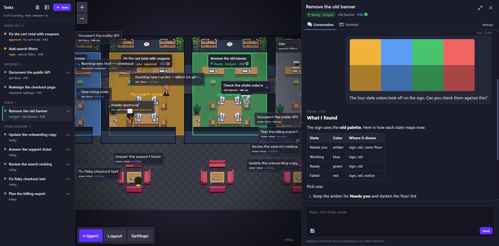

# worktree-office

A pixel-art office for your git worktrees and the Claude Code agents working in them.

worktree-office is a fork of [Pixel Agents](https://github.com/pixel-agents-hq/pixel-agents). It keeps everything Pixel Agents does, where every Claude Code session becomes an animated character, and adds what you need when you run several agents in parallel, one git worktree per task.

> Status: early development. Expect breaking changes.



## Why

With five agents working in five worktrees, the hard questions are not about code:

- Which tasks are still running, and which ones are waiting for me?
- Which pull request is ready for my review?
- Which worktree can I clean up, and which one is still in use?

worktree-office answers them on one screen. Each worktree becomes a room, each session sits in the room of the worktree it works on, and each room shows the state of its branch and pull request.

## Roadmap

- [x] One room per git worktree, kept in sync as worktrees come and go
- [x] Sessions running inside a worktree sit in its room; everything else waits in the lobby
- [x] Launching Claude Code into a worktree from the browser, on Windows too
- [x] Sessions that work on a worktree from outside it, through `git -C` or file edits, move to its room
- [x] Door signs with branch, pull request status, checks and dev server port
- [x] A "needs you" panel: sessions waiting for input or permission, pull requests waiting on you, stale worktrees
- [x] One-click release of a worktree: stop its dev server, stash leftovers, then detach or remove it
- [x] A task box that starts new tasks in free worktrees, with a limit on how many run at once
- [x] Tokens used by each task
- [x] Session titles and idle time on the character labels
- [x] System notifications when something new needs you
- [x] Demo mode with a fictional project
- [ ] GitLab merge requests

## Getting started

worktree-office is not on npm yet. Run it from source with Node.js 20 or later and Claude Code installed:

```bash
git clone https://github.com/MarcosNespolo/worktree-office.git
cd worktree-office
npm install
npm run compile
node dist/cli.js --port 3100
```

Want to look around first? `node dist/cli.js --demo` opens a fictional project with six worktrees, simulated agents and fictional pull requests. It runs in a temporary folder and never touches your hooks, sessions or settings.

Open the URL printed in the terminal. It carries an access token, so treat it like a password.

On first run, the office asks for permission to add hooks to `~/.claude/settings.json`, so it can follow your sessions as they happen. You can remove them anytime from Settings.

The hooks run in the background, so they never slow Claude Code down, and they send only what the office needs: event names, tool names, paths and commands, never tool output. Set `PIXEL_AGENTS_DEBUG=1` to get verbose server logs.

worktree-office keeps its data in `~/.worktree-office/`, separate from Pixel Agents, so both can be installed side by side.

## Configuration

By default, worktree-office watches the git repository it was started in. To watch other repositories, or several at once, create `~/.worktree-office/projects.json` (or point the `WORKTREE_OFFICE_PROJECTS` environment variable at another file):

```json
{
  "projects": [
    {
      "name": "acme-web",
      "root": "~/code/acme-web",
      "include": ["~/code/acme-web-*"],
      "exclude": ["~/code/acme-web-scratch"]
    }
  ]
}
```

| Field             | Meaning                                                                |
| ----------------- | ---------------------------------------------------------------------- |
| `name`            | Project name used in logs. Defaults to the folder name.                |
| `root`            | Any checkout of the repository. Its worktrees become rooms.            |
| `include`         | Optional globs. When present, only matching worktrees become rooms.    |
| `exclude`         | Optional globs. Matching worktrees never become rooms.                 |
| `includeMain`     | Set to `true` to give the main checkout a room too.                    |
| `followToolPaths` | Set to `false` to stop moving sessions by the paths their tools touch. |

Room names come from the worktree folder without the repository prefix, so `acme-web-fix-login` becomes `fix-login`. The office holds up to 24 rooms. The layout is generated, so edits made in the layout editor are replaced when worktrees change.

Sessions come and go with their conversation. A session joins the office when it exchanges a message, and leaves after 2 hours without one, so sessions left open for days do not crowd the lobby. It comes back as soon as the conversation continues. Change the limit with a top-level `"sessions": { "hideAfterIdleMinutes": 120 }`, or use `0` to keep every session.

A session that is not working shows the title Claude Code gave it, or the one set with `/rename`, and how long it has been idle, for example `checkout-redesign · idle 25m`.

### Door signs and the task list

Each room shows a sign with the title of its task and its state, plus the number of its pull request and an icon for its checks. Click a sign to open the task. A free room only says "free", with its dev server port when it has one.

Every room takes the color of its state, on its floor, on its frame and on its sign: amber when it needs you, blue while it works, green when it is ready, gray when it is idle, red when it failed. A room that needs you has a frame that breathes, so it catches the eye. The lobby floor stays dark and quiet, so the rooms stand out.

While a session works, its state says what it is doing, judged from its tool calls: **planning** in plan mode, **coding** while editing files, **testing** while running test commands or a browser, **reviewing** while a review sub-agent runs, **reading** while only reading. Reads and plain commands do not override coding, testing or reviewing for three minutes, so the state does not flicker. A session with no message for ten minutes shows how long it has been idle instead. Pull requests come from the [GitHub CLI](https://cli.github.com/), so install it and run `gh auth login` once.

Character labels show the session title and its state. Hover over a character, or select it, to see the tool it is using.

The task list on the left groups everything by state:

- **Needs you**: sessions asking for approval or waiting for your reply, tasks blocked on a question, pull requests with changes requested or failing checks, and field rules that ask for you;
- **Working**: sessions at work, with their stage, and tasks that are starting;
- **Ready**: pull requests approved and ready to merge, merged pull requests whose worktree can be released, and field rules marked as ready, such as a pull request waiting for your QA;
- **Queued** and **Idle**: tasks waiting for a free worktree, and rooms where nobody works;
- **Other sessions**: sessions outside the task worktrees.

Each row shows a title (the pull request title, or else the session, the task or the branch), the reason in the state color, the room and the pull request. A room without a session of its own takes the session that most recently linked its pull request, so its conversation is one click away. Arrow keys move through the list, and the bell at its top turns on a system notification for each new item that needs you while the office tab is not focused.

### The task panel

Click a row of the task list, or a character, and the task panel opens on the right. Its header says what the task is doing, in the same color as its row. It also shows the room, the dev server port, which opens the app, and the pull request with its checks, plus **Release** when the room has a branch. A newly started task opens the panel on its terminal when nothing else is open. Drag the panel's left edge to resize it.

- **Conversation** shows the recent messages of the session with a reply box under them. Messages are rendered as Markdown, tables and task lists included, and images pasted into the conversation show inline. Long lines in code blocks wrap, and numbered lists keep their numbers, so you can answer by number. When a session running in an office terminal asks for permission, it shows **Approve** and **Deny**.
- **Terminal** shows the office terminal of the session. A session running elsewhere, for example in VS Code, can be continued in an office terminal with `claude --resume`, just as a reply would be, so use it only there from then on.

The full screen button spreads the panel over the whole office, and Esc brings it back.

The reply box under the conversation works for any session:

- a session running in an office terminal gets your reply typed in;
- any other session, for example one open in VS Code, is continued in a new office terminal with `claude --resume`, and your reply goes in once Claude Code is ready. From then on, answer that conversation only in the office, or it splits in two;
- a session that is still working refuses replies until it stops.

These project fields tune the signs and the panel:

| Field       | Meaning                                                                                                                                                                                                                                                               |
| ----------- | --------------------------------------------------------------------------------------------------------------------------------------------------------------------------------------------------------------------------------------------------------------------- |
| `github`    | `owner/repo` to read pull requests from, or `false` to skip them. Defaults to the `origin` remote.                                                                                                                                                                    |
| `devServer` | Dev server of each room, for example `{ "portBase": 3000, "portStep": 100, "ports": { "main-app": 3001 }, "url": "http://localhost:{port}" }`. The port comes from the first number in the room name or from `ports`.                                                 |
| `fields`    | Extra values read from each pull request, for example `{ "name": "stage", "pattern": "^stage:(.+)$", "from": "labels" }`. `from` is `body` (default) or `labels`, and the first capture group is the value. Only open and draft pull requests have fields.            |
| `needsYou`  | Rules that turn a field into a reason on the task list, for example `{ "field": "stage", "values": ["qa"], "title": "Ready for your QA", "state": "ready" }`. `state` is `attention` (default), `ready` or `idle`.                                                    |
| `stages`    | Patterns that decide **testing** and **reviewing**, for example `{ "testing": "pytest\|tox", "reviewing": "review\|audit" }`. `testing` is matched against shell commands, `reviewing` against sub-agent descriptions and prompts; each replaces the default pattern. |

### Releasing a worktree

Every door sign with a branch checked out or a dev server running has a **release** button, and so does the task panel of such a room. One click:

1. asks first when the pull request is still open, when sessions started from the office are working there, or when files changed;
2. runs the cleanup commands of the project;
3. stashes changed files, so nothing is lost;
4. stops the dev server listening on the room port;
5. checks out the default branch detached, or removes the worktree.

Every release is logged in `~/.worktree-office/release.log`. The main checkout is never released.

| Field     | Meaning                                                                                                                                                                                                                                                                                                                                                                                       |
| --------- | --------------------------------------------------------------------------------------------------------------------------------------------------------------------------------------------------------------------------------------------------------------------------------------------------------------------------------------------------------------------------------------------- |
| `release` | `{ "mode": "remove", "keep": ["~/code/acme-web-slot*"], "before": ["npm run clean"] }`. `mode` is `detach` (default: keep the folder, check out the default branch) or `remove` (delete the worktree). With `remove`, worktrees matching the `keep` globs are detached instead, which suits worktrees you reuse for every task. `before` commands run in the worktree, in the platform shell. |

### Starting tasks

Click **New** at the top of the task list, describe one or more tasks and press **Start** (or Ctrl+Enter). The line under the list title says how many tasks are running and which worktrees are free. Separate tasks with a blank line, or write them as a list. Each task:

1. waits until fewer than `maxActive` tasks are running;
2. takes a free worktree, meaning one with no branch checked out and nobody working in it, or creates one when `createWorktree` is set;
3. starts Claude Code in that worktree, inside the office terminal;
4. receives its prompt through the terminal, never on a command line, once Claude Code is ready.

When Claude Code asks whether to trust a new folder, or asks for approval, the task moves to **Needs you**. Sessions started from the office can be answered from the task panel: type a reply, or 1, 2 or 3 to pick a menu option. A task waiting on the folder question never answers it by itself, and its prompt goes in only after you reply.

A task is done when its session closes.

Images go along: paste them into the task box or the reply box, drop them there, or click **attach**. The office stores each image under `~/.worktree-office/uploads/`, keeps it for a week, and puts its path at the end of the text it types, so Claude Code attaches the image to the prompt. With several tasks in one request, every task gets the images.

Each task row shows the tokens its session has used so far: input, cache reads and writes, and output, sub-agents included. It is a measure of usage, not a price.

| Field               | Meaning                                                                                                                                                                                                                                                                                                                                                                                                                                                                                                                                                                                                   |
| ------------------- | --------------------------------------------------------------------------------------------------------------------------------------------------------------------------------------------------------------------------------------------------------------------------------------------------------------------------------------------------------------------------------------------------------------------------------------------------------------------------------------------------------------------------------------------------------------------------------------------------------- |
| `tasks` (top level) | `{ "maxActive": 3, "split": "lines" }`. `split` is `lines` (paragraphs or list items) or `claude`, which asks Claude Code to split free text into tasks.                                                                                                                                                                                                                                                                                                                                                                                                                                                  |
| `launch`            | `{ "prompt": "{text}", "skipPermissions": false, "rooms": ["~/code/acme-web-slot*"] }`. `prompt` is the text sent to the agent, with `{text}`, `{title}`, `{room}`, `{path}`, `{branch}` and `{port}` filled in. `skipPermissions` starts Claude Code with `--dangerously-skip-permissions`. `rooms` limits which worktrees take tasks, as path globs; by default any free worktree of the project can. With `rooms` set, a worktree only gets a room while it has a branch checked out, a session working inside it or its dev server running; free ones wait off screen and are listed in the task box. |
| `createWorktree`    | `{ "path": "~/code/acme-web-{slug}", "branch": "task/{slug}", "copy": [".env.local"], "after": ["npm install"] }`. Creates a worktree when none is free. `path` takes `{slug}` or `{n}`, `copy` brings untracked files from the main checkout, and `after` runs setup commands.                                                                                                                                                                                                                                                                                                                           |

## Credits

- [Pixel Agents](https://github.com/pixel-agents-hq/pixel-agents) by Pablo De Lucca and contributors, under the MIT License. The office, the characters and the Claude Code integration come from there. The [Pixel Agents README](https://github.com/pixel-agents-hq/pixel-agents#readme) covers everything about the office itself.
- Characters based on the [Metro City](https://jik-a-4.itch.io/metrocity-free-topdown-character-pack) pack by JIK-A-4 (CC0).

## License

[MIT](LICENSE)
